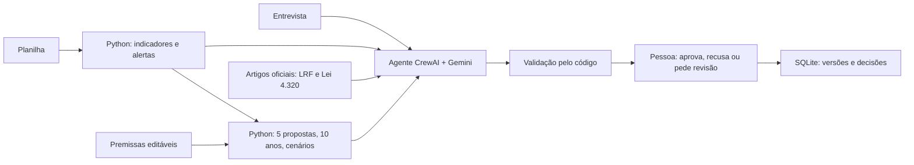

# LeopoldinAI

A identidade aprovada está em `assets/branding/logo.png` (símbolo à esquerda e nome) e `assets/branding/icon.png` (símbolo isolado). O cabeçalho usa fundo branco para preservar a marca azul; o ícone também aparece na aba do navegador.

Protótipo de apoio à decisão para o estudo de caso da **Prefeitura de Santa Leopoldina** (trabalho final, UFSM). O app lê a planilha de receitas, despesas, dívida ativa e folha, simula cinco medidas para reduzir o déficit e entrega as propostas a uma pessoa, que aprova, recusa ou pede revisão.

A arquitetura é a de **agente único com validação humana**, uma das duas permitidas pelo enunciado: um agente CrewAI com o modelo Gemini e três ferramentas. **A IA interpreta, o Python calcula e a pessoa decide.**

Para o estado atual do projeto e o que falta entregar, veja o [handoff.md](handoff.md).

## Baixar o projeto

```powershell
git clone https://github.com/LeonardoBalk/agentes.git
cd agentes
```

Depois, na primeira vez, rode **`instalar.bat`** e crie o `.env` (ver "Ligar o agente de IA" abaixo). O repositório não traz o banco local (`runtime/`): as respostas da entrevista, os papéis e as decisões precisam ser cadastrados de novo, ou o arquivo `runtime/municipal.sqlite3` precisa ser copiado de quem já tem.

## Abrir o app

No Windows, dê dois cliques em **`iniciar.bat`**. O navegador abre em **http://127.0.0.1:8765**. O terminal precisa continuar aberto; `Ctrl+C` encerra o servidor. Se a porta estiver ocupada, use `.\.venv\Scripts\python.exe main.py --port 8766 --open`.

Na primeira vez, ou se faltar alguma dependência, rode **`instalar.bat`**. É preciso Python 3.11, 3.12 ou 3.13, e o CrewAI ocupa bastante espaço em disco.

### Ligar o agente de IA

Sem chave, o app funciona em **modo demonstração**: os cálculos são os mesmos, mas a ordem das propostas sai de regras fixas, sem chamar um LLM. Para usar o agente:

```powershell
Copy-Item .env.example .env
```

Abra o `.env` e preencha `LLM_API_KEY` com uma chave do [Google AI Studio](https://aistudio.google.com/apikey). O modelo padrão é `gemini/gemini-3.5-flash`. Reinicie o servidor; o selo do canto superior passa a mostrar "Agente de IA ligado".

### Modelos reserva

Se o modelo principal falhar, o app tenta os modelos reserva configurados no `.env`, nesta ordem:

1. **`LLM_RESERVA_MODEL`**: outro modelo Gemini com a mesma chave. O padrão sugerido é `gemini/gemini-3.5-flash-lite`, que tem cota própria e responde em menos de 30 segundos.
2. **`GROQ_API_KEY`** (e `GROQ_MODEL`, padrão `openai/gpt-oss-120b`): chave gratuita do [Groq](https://console.groq.com). O plano gratuito aceita só 8.000 tokens por minuto, então esse modelo recebe uma **versão resumida dos dados**. O app conduz as chamadas e as espaça para caber no limite, e a análise leva cerca de 2 minutos.

As regras de validação valem para todos os modelos. Quando uma análise vem de um modelo reserva, a tela de Revisão mostra qual modelo falhou, por quê, e quem respondeu. Sem essas variáveis, não há reserva.

O `.env` está no `.gitignore` e nunca vai para o `.zip`. Não coloque as chaves em nenhum outro arquivo.

## Como usar

O app tem quatro telas. As três primeiras seguem a ordem do raciocínio, indicada no topo de cada uma.

1. **Situação atual.** Totais, sete alertas calculados com a planilha (resultado, arrecadação, despesa acima da dotação, folha, dívida ativa, convênios e restos a pagar) e a divisão da despesa por secretaria. Tabelas, limitações, fontes, funcionamento interno e glossário ficam recolhidos em "Quer ver mais detalhes?".
2. **Simulação.** Um bloco por proposta, cada um com o que a medida faz, seus controles e quanto ela rende com os valores escolhidos. Custos de implantação e a reposição opcional por temporários ficam em "Opções avançadas", com um resumo visível mesmo fechado. A tela mostra o resultado em 12 meses, a projeção de 10 anos, quanto do déficit recorrente o plano cobre, três cenários (conservador, base e otimista) e, se o plano não fechar, uma **alternativa de equilíbrio para estudar**. No fim, "Gerar análise" salva a versão e chama o agente.
3. **Revisão e decisão.** Cada proposta abre ao clicar. Quem revisa informa nome, decisão e justificativa; o Refis exige também o nome de um aprovador em nível superior. A barra do topo mostra quantas propostas já têm decisão. O resultado pode ser baixado em JSON ou CSV.
4. **Equipe e entrevista.** Papéis do grupo e as respostas da entrevista com o cliente, que o agente recebe.

Termos como LRF, DAS, Refis, FIFO e despesa liquidada têm explicação ao passar o mouse.

## Como funciona



- **O agente** usa três ferramentas: `consultar_indicadores` (planilha, alertas e entrevista), `consultar_simulacao` (propostas, projeção, cenários, meta e alternativa) e `consultar_fontes_oficiais`. Elas correspondem aos papéis do roteiro de entrevista: o agente financeiro e o operacional viram as duas primeiras ferramentas, o de coleta externa vira a terceira, e o revisor é a pessoa.
- **O código valida a resposta**: rejeita propostas desconhecidas ou repetidas, fontes não consultadas e respostas que não usaram as três ferramentas. Isso não garante que todo o texto esteja certo; a pessoa precisa ler.
- **Fontes externas**: o app recupera artigos específicos nos sites oficiais. São os arts. 14, 19, 20, 22 e 42 da LRF e os arts. 58, 62, 63 e 64 da Lei 4.320/1964, e esses trechos vão ao agente como contexto. É uma **recuperação fixa de artigos oficiais como contexto**, sem busca semântica nem banco vetorial. Do Manual de Demonstrativos Fiscais (Tesouro) só a página de apresentação é lida.
- **Erros do provedor**: em 503 (alta demanda), limite por minuto ou demora, o app tenta o mesmo modelo de novo até três vezes. Se a cota do dia acabou (429 com espera longa), ele não insiste e passa direto para o próximo modelo da lista de reservas. Erros permanentes, como chave recusada ou modelo indisponível, aparecem com uma mensagem clara e nada é salvo como sucesso.

## As cinco propostas

Os percentuais são **hipóteses do grupo**, inspiradas na entrevista de 15/10/2026, mas não confirmadas pelo cliente.

| Proposta | Base | Hipótese padrão | Efeito |
|---|---|---|---|
| 1. Recuperar a dívida ativa | Recuperação estimada pela planilha (R$ 36,23 mi) | 20% em 12 meses; custo R$ 500 mil | Pontual (ano 1) |
| 2. Revisar o custeio | Despesa menos folha e investimentos de Administração, Meio Ambiente e Segurança | 5%, 3% e 2%; custo R$ 100 mil | Recorrente |
| 3. Reduzir cargos de confiança | 181 cargos DAS, R$ 20,2 mi por ano com encargos | Corte de 15%; transição R$ 300 mil | Recorrente |
| 4. Refis do IPTU | IPTU inscrito menos a recuperação já estimada (R$ 33,6 mi) | Adesão de 10%, desconto de 30% sobre o valor total devido; custo R$ 200 mil | Pontual; exige aprovação superior |
| 5. Ordem de pagamentos | Hoje os pagamentos seguem FIFO | Sem valor estimado | Governança |

A reposição de administrativos por contrato temporário existe como opção avançada, mas **começa em 0% e não entra no cenário padrão**. O STF (Tema 612) só admite temporário para necessidade temporária e excepcional, nunca para serviço permanente.

### Restrições do cliente aplicadas pelo código

- Nenhuma proposta aumenta alíquota ou cria tributo.
- Medida de tributação só é aprovada com o nome de um aprovador em nível superior.
- Concursados não são demitidos.
- O horizonte é de 10 anos.

O teto de 50% no desconto do Refis **não é do cliente**: é uma escolha do grupo, porque o cliente só pediu cuidado para a cobrança não ficar irrisória.

## Resultados com os dados fornecidos

| Medida | Valor |
|---|---:|
| Receita arrecadada | R$ 577,3 mi |
| Despesa liquidada | R$ 584,5 mi |
| Resultado simples | −R$ 7,2 mi |
| Arrecadação abaixo do previsto | R$ 65,2 mi (90% do previsto) |
| Dívida ativa | R$ 100,1 mi (36% com recuperação estimada) |
| Servidores listados | 2.409 |

**Plano-base (hipóteses padrão):** +R$ 5,25 mi no ano 1, mas −R$ 3,25 mi por ano do ano 2 ao 10, porque dívida e Refis rendem uma vez só. As medidas recorrentes cobrem 55% do déficit anual, e o acumulado em 10 anos é −R$ 23,97 mi. **O plano-base não fecha o déficit recorrente.**

**Alternativa de equilíbrio:** cortar **32% dos gastos com cargos de confiança** (cerca de 58 cargos pelo custo médio), mantendo o resto, deixa os 10 anos positivos: +R$ 8,69 mi no ano 1, +R$ 0,19 mi por ano depois e +R$ 10,42 mi no acumulado. Ela **não se sustenta no cenário conservador** (pior ano: −R$ 3,50 mi) e não foi validada: equilíbrio matemático não comprova viabilidade administrativa.

Todos os valores são constantes, sem inflação nem crescimento, e condicionados às hipóteses.

## Limites

- **Despesa liquidada não é despesa paga.** A planilha traz a liquidada; o pagamento é a etapa seguinte (Lei 4.320, arts. 58 a 64). O saldo da tela é "receita arrecadada menos despesa liquidada", não caixa.
- **Não há conclusão sobre conformidade legal.** A razão folha/receita é simples e não substitui o teste da LRF, que depende da RCL oficial. O app também não conclui nada sobre resultado primário, saúde, educação, FUNDEB ou restos a pagar.
- **O Refis tem duas hipóteses sem dado:** a planilha não separa principal, juros e multa, e não prova que quem adere ao Refis é diferente de quem pagaria pela cobrança normal.
- **Pontos em aberto, que ficam como recomendações para a implementação:**
  - período exato das despesas;
  - quais cargos de confiança podem sair;
  - quem é o aprovador superior e qual instrumento legal o Refis exige;
  - contas a pagar por faixa, para avaliar a ordem de pagamentos.
- **Uso local apenas.** O app é um protótipo para uma máquina: não tem autenticação nem trilha inviolável. Não exponha em rede pública.

### O que vai para os provedores de IA

As chamadas de IA (Google e, se a reserva for usada, Groq) enviam indicadores agregados, premissas, limitações, respostas da entrevista e trechos das leis. A lista individual de servidores e os nomes da equipe não são enviados.

## Estrutura

```text
main.py                 Servidor HTTP local (biblioteca padrão) e rotas da API
municipal/
  dados.py              Leitura da planilha, indicadores e diagnóstico da situação atual
  simulacao.py          As 5 propostas, projeção de 10 anos, cenários, meta e alternativa de equilíbrio
  agente.py             Um agente CrewAI, três ferramentas, validação da resposta, novas tentativas e modelos reserva
  fontes.py             Recuperação dos artigos oficiais (LRF e Lei 4.320) e da página do MDF
  storage.py            Versões das análises, decisões e entrevista em SQLite
web/
  index.html, app.js    As quatro telas
  style.css             Visual inspirado no Carbon Design System, sem dependências externas
data/
  estudo_municipal.xlsx Cópia da planilha fornecida (bytes idênticos ao original)
tests/                  Testes de cálculo, API, integração CrewAI e Trello
scripts/, trello/       Criação opcional do quadro Trello do grupo (ver trello/README.md)
runtime/                Banco, cache das fontes e logs (local, fora do .zip)
```

## Testes

```powershell
.\.venv\Scripts\python.exe -m unittest discover -s tests -p "test_*.py" -v
node --check web/app.js
```

São 41 testes. Eles cobrem os totais da planilha, as cinco propostas, a projeção de 10 anos, os cenários, a meta e a alternativa de equilíbrio, o teto do Refis, a aprovação superior, a recuperação de artigos, as novas tentativas em erro do provedor, a cadeia de modelos reserva (inclusive a cota diária esgotada), o caminho do Groq, a API e a exportação. O teste de integração usa o **CrewAI de verdade contra um LLM local simulado**, sem chave nem custo; ele confirma o fluxo de ferramentas, não a qualidade de um modelo real.

### Modelos testados (17 a 19/10/2026)

| Modelo | Resultado |
|---|---|
| `gemini-3.5-flash` | Quando responde, conclui em 36 a 80 segundos usando as três ferramentas. É o padrão. Em alguns horários o Google devolve 503 (alta demanda) mesmo depois das três tentativas; espere alguns minutos e gere de novo. |
| `gemini-3.5-flash-lite` | Passou em 4 de 4 execuções, em 13 a 25 segundos, com as três ferramentas e as cinco propostas certas. É a primeira reserva. |
| Groq `openai/gpt-oss-120b` (dados resumidos) | Passou em 4 de 4 execuções, em cerca de 130 segundos. É a segunda reserva. Pelo conector padrão do CrewAI o Groq não funciona: recusa o formato e estoura o limite por minuto. |
| `gemini-3.1-flash-lite` | Não consultou nenhuma ferramenta e inventou propostas e fontes (`PROP_001`, `FONTE_OFICIAL_01`). A validação descartou as 4 respostas. |
| `gemini-flash-latest` | Levou 146 segundos e errou as propostas. O atalho muda sem aviso. |
| `gemini-2.5-flash`, `2.5-flash-lite`, `2.5-pro` | Aparecem na lista, mas recusam contas novas. |

A ordem das propostas muda entre execuções, como é normal num modelo de linguagem. Modelos lentos podem pedir `LLM_TIMEOUT` e `LLM_MAX_SECONDS` maiores no `.env`.

## Referências

- Enunciado do trabalho final e roteiro de entrevista (Prefeitura de Santa Leopoldina, 15/10/2026).
- [Lei Complementar 101/2000 (LRF)](https://www.planalto.gov.br/ccivil_03/leis/lcp/lcp101.htm)
- [Lei 4.320/1964](https://www.planalto.gov.br/ccivil_03/leis/l4320.htm)
- [Manual de Demonstrativos Fiscais, Tesouro Nacional](https://www.gov.br/tesouronacional/pt-br/contabilidade-e-custos/manuais/manual-de-demonstrativos-fiscais-mdf)
- STF, Tema 612 (RE 658.026): requisitos da contratação temporária.
- [CrewAI: agentes](https://docs.crewai.com/en/concepts/agents), [ferramentas](https://docs.crewai.com/en/learn/create-custom-tools) e [conexão a LLMs](https://docs.crewai.com/en/learn/llm-connections)
- [Carbon Design System](https://carbondesignsystem.com), referência visual.
